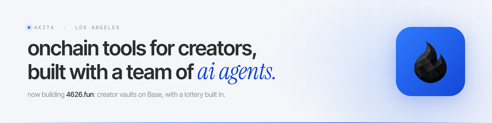
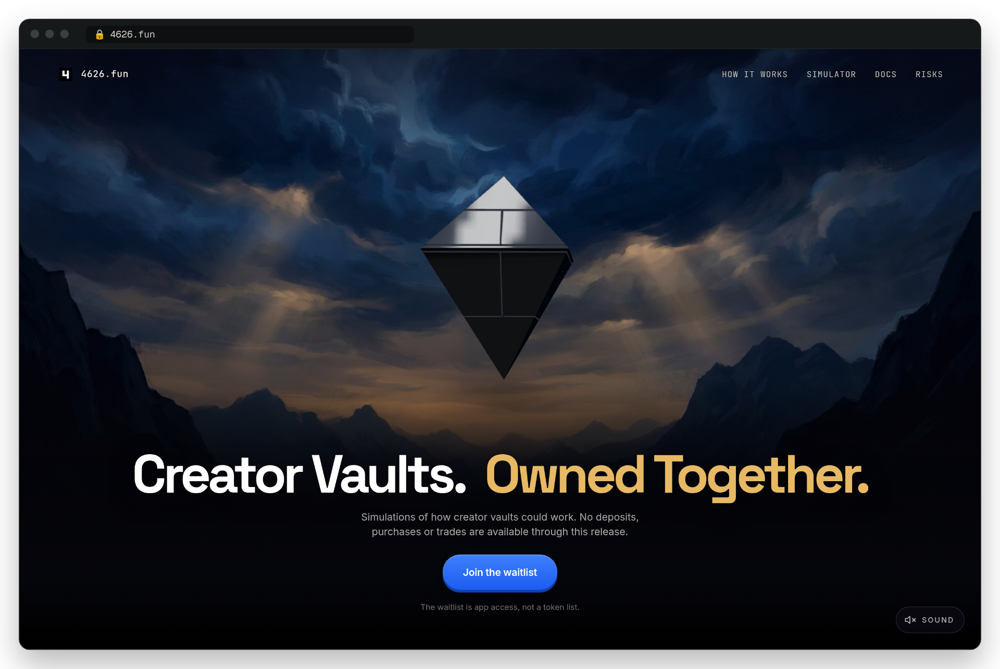
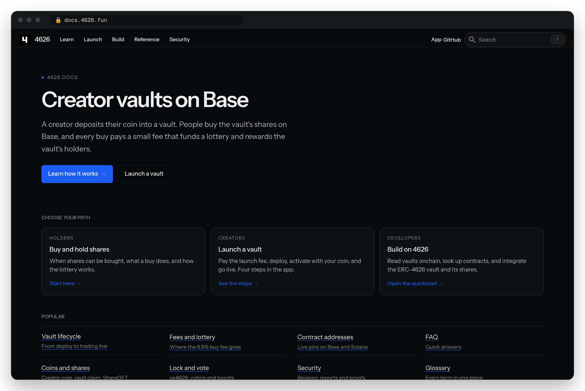

<a href="https://4626.fun">
  <picture>
    <source media="(prefers-color-scheme: dark)" srcset="assets/banner-dark.png">
    <source media="(prefers-color-scheme: light)" srcset="assets/banner-light.png">
    
  </picture>
</a>

  
  
  
  

hi, i'm akita 🐕 i build onchain stuff for creators. ai agents do most of the typing; i decide what gets built and what's allowed to ship.

## now: 4626

  
  

**[4626](https://4626.fun)** gives every creator their own [ERC-4626](https://eips.ethereum.org/EIPS/eip-4626) vault on Base. a creator puts their coin in, fans buy shares, and every buy pays a 6.9% fee. most of that fee goes into a lottery pot, and every buy is a ticket. fun matters.

it's in private beta. the [simulator](https://4626.fun) and [docs](https://docs.4626.fun) are public.

<b>how i got here</b>

 

i spent a while on **omnidragon**, a swap-to-win lottery across chains. then i noticed people didn't want to just play a lottery. they wanted to build their own brand with their own coin, the way zora works. so i shelved it and built 4626 around that. the lottery came along for the ride.

## how i build

- **start silly, finish serious.** repo names are jokes. the proofs aren't.
- **one job per agent.** ai agents write most of the code. each one gets a single job and a clear lane.
- **nothing merges on vibes.** a change ships when tests, formal verification and review back it up, plus a yes from me on that exact change. one formal-verification pass proved 44 of 45 properties.
- **automate the checking.** right now i'm the last gate. i'm working on automating that part too.
- **build privately, publish proof.** what goes public is something you can check: rebuildable audit snapshots, a hackathon entry, docs.

## poke around

| project | what it is |
|:--|:--|
| [**4626fun/monorepo**](https://github.com/4626fun/monorepo) | the public side of 4626: contracts, frontend, indexer and docs. |
| [**creator-vaults-audit**](https://github.com/4626fun/creator-vaults-audit) | a pinned source snapshot with tests anyone can rerun, made for independent security review. |
| [**convergence-chainlink-hackathon**](https://github.com/4626fun/convergence-chainlink-hackathon) | my Chainlink hackathon entry: Chainlink CRE workflows that check 4626 payout wiring, with a 2-minute judge quickstart. |
| [**4626-Brand-Kit**](https://github.com/wenakita/4626-Brand-Kit) | logos, colors and social images for 4626 (from before the new flame logo). |

---

building in los angeles · say hi on <a href="https://x.com/wenakita">x</a>

